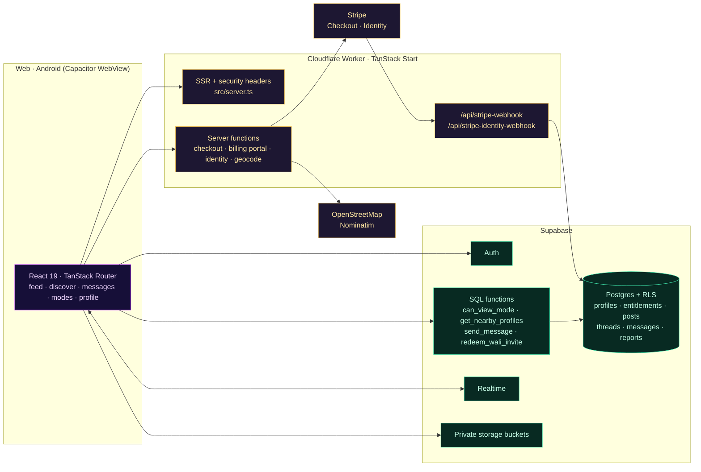

<p align="center">
  
</p>

<p align="center">
  
</p>

<p align="center">
  <a href="https://github.com/kamikaze1120/soul-soulmate-space/commits/main"></a>
  
  
  
  
</p>

**Ummah** (repo: `soul-soulmate-space`) is a mobile-first, high-trust community app for Muslims, organised into three private spaces: **Nikah** for adults seeking marriage, **Sisterhood** for verified mothers and **Brotherhood** for verified fathers. Every member passes ID verification before any space opens, a Nikah conversation can bring in the woman's **wali** (guardian) through an invite link, and access rules live in Postgres row-level security — not just the UI. It runs as a TanStack Start app on Cloudflare Workers with a Supabase backend, and ships an Android shell via Capacitor.

<p align="center"><sub><code>TANSTACK START</code> ✦ <code>REACT 19</code> ✦ <code>SUPABASE</code> ✦ <code>STRIPE</code> ✦ <code>CLOUDFLARE WORKERS</code> ✦ <code>CAPACITOR</code></sub></p>

<h2 align="center">✦ THREE SPACES ✦</h2>
<p align="center"><sub>WHO SEES WHAT — MIRRORED IN <code>eligibleModes()</code> AND <code>can_view_mode()</code></sub></p>

| Space | DB enum | For | Eligible when |
|---|---|---|---|
| 💍 **Nikah** | `matrimonial` | Adults seeking marriage — wali-friendly, modesty-first | verified **and** marital status is not `married` |
| 🌸 **Sisterhood** | `sisterhood` | Verified Muslim mothers — meetups, advice, halaqas | verified **and** profile gender is `female` |
| 🌿 **Brotherhood** | `brotherhood` | Verified Muslim fathers — meetups, mentorship | verified **and** profile gender is `male` |

Eligibility alone is not access: the database also requires an active membership entitlement. Admins bypass the gates; **wali** accounts get no space at all and only see the threads they were invited into.

<h2 align="center">◈ FEATURES ◈</h2>
<p align="center"><sub>WHAT'S WIRED UP IN THE CODE TODAY</sub></p>

<table>
  <tr>
    <td width="33%" valign="top">🪪 <b>ID verification</b><br><sub>Stripe Identity hosted document + selfie check; a webhook marks the profile verified.</sub></td>
    <td width="33%" valign="top">💳 <b>One membership</b><br><sub>Stripe Checkout subscription ($10.99/mo) that covers every space you qualify for, a 7-day trial and a billing portal.</sub></td>
    <td width="33%" valign="top">📰 <b>Per-space feed</b><br><sub>Photo or short-video posts, events and polls, with likes, comments and poll voting.</sub></td>
  </tr>
  <tr>
    <td valign="top">📍 <b>Nearby discover</b><br><sub>Set location by GPS or city search (OpenStreetMap Nominatim), then browse members within 5–250 miles.</sub></td>
    <td valign="top">🤝 <b>Connection requests</b><br><sub>Send a request from Discover; the other member accepts or declines.</sub></td>
    <td valign="top">💬 <b>Realtime messages</b><br><sub>DMs and groups over Supabase Realtime; groups are single-gender unless cross-gender is switched on.</sub></td>
  </tr>
  <tr>
    <td valign="top">🛡️ <b>Wali invites</b><br><sub>Invite-only wali role, redeemed via <code>/wali-invite/$token</code> and added to the Nikah thread.</sub></td>
    <td valign="top">🙈 <b>Modesty controls</b><br><sub>Photo blur toggle in Discover; profile photos, post images and verification videos live in private buckets.</sub></td>
    <td valign="top">🚩 <b>Reports &amp; moderation</b><br><sub>Members report content; admins work the queue at <code>/admin/reports</code>. Public child-safety and privacy pages.</sub></td>
  </tr>
</table>

<h2 align="center">◆ ARCHITECTURE ◆</h2>
<p align="center"><sub>EDGE SSR · POSTGRES RULES · HOSTED VERIFICATION</sub></p>



<details>
<summary><b>Database at a glance</b> (23 migrations in <code>supabase/migrations/</code>)</summary>

| Kind | Names |
|---|---|
| Tables | `profiles`, `mode_entitlements`, `user_roles`, `posts`, `post_likes`, `post_comments`, `poll_options`, `poll_votes`, `threads`, `thread_members`, `messages`, `connection_requests`, `reports`, `wali_invites` |
| Enums | `gender`, `app_mode`, `marital_status`, `app_role` (`admin`, `user`, `wali`) |
| Functions | `can_view_mode`, `has_role`, `handle_new_user`, `create_post`, `vote_on_poll`, `start_dm_thread`, `send_message`, `is_thread_member`, `create_group`, `invite_to_group`, `get_connections`, `send_connection_request`, `respond_to_connection_request`, `get_nearby_profiles`, `create_wali_invite`, `get_wali_invite_info`, `redeem_wali_invite`, `add_wali_to_thread`, `set_updated_at` |
| Storage | private buckets `verification-videos`, `profile-photos`, `post-images` |

</details>

<details>
<summary><b>Routes</b> (<code>src/routes/</code>)</summary>

| Route | Purpose |
|---|---|
| `/` | Public landing page |
| `/auth` | Sign in / sign up |
| `/privacy` · `/child-safety` | Public policy pages |
| `/wali-invite/$token` | Redeem a wali invite |
| `/onboarding` · `/verify` | Profile setup and Stripe Identity hand-off (signed in) |
| `/feed` · `/discover` · `/messages` · `/messages/$id` · `/modes` · `/profile` | The app (signed in; `/dashboard` redirects to `/feed`) |
| `/admin/reports` | Moderation queue (admins) |
| `/api/stripe-webhook` · `/api/stripe-identity-webhook` | Stripe webhooks |

</details>

<h2 align="center">✦ TECH STACK ✦</h2>
<p align="center"><sub>FROM <code>package.json</code></sub></p>

<p align="center">
  
</p>

| Layer | What's used |
|---|---|
| App framework | TanStack Start + Router (file-based routes), React 19, Vite 7 |
| Data | Supabase JS (Auth, Postgres RPC, Realtime, Storage), TanStack Query, Zod, React Hook Form |
| UI | Tailwind CSS 4, shadcn/ui on Radix, Framer Motion, Lucide, Sonner |
| Payments / trust | `stripe` (Checkout, Billing Portal, Identity) |
| Native | Capacitor 8 (Android project in `android/`, camera, splash screen, status bar) |
| Hosting | Cloudflare Workers (`wrangler.jsonc`) |

<h2 align="center">◈ RUN IT LOCALLY ◈</h2>
<p align="center"><sub>YOU BRING THE SUPABASE PROJECT AND STRIPE KEYS</sub></p>

```bash
git clone https://github.com/kamikaze1120/soul-soulmate-space.git
cd soul-soulmate-space
cp .env.example .env      # fill in your own values
npm install
npm run dev
```

Apply `supabase/migrations/` to your Supabase project (for example with `supabase db push` from the Supabase CLI), then open the URL Vite prints. Without Stripe keys the app runs, but verification and checkout will fail.

<details>
<summary><b>Environment variables</b> (names only — see <code>.env.example</code>)</summary>

| Variable | Used for |
|---|---|
| `VITE_SUPABASE_URL`, `VITE_SUPABASE_PUBLISHABLE_KEY`, `VITE_SUPABASE_PROJECT_ID` | Browser Supabase client |
| `SUPABASE_URL`, `SUPABASE_PUBLISHABLE_KEY`, `SUPABASE_PROJECT_ID` | Server-side Supabase client |
| `SUPABASE_SERVICE_ROLE_KEY` | Server-only admin client (webhooks) — never prefix with `VITE_` |
| `STRIPE_SECRET_KEY` | Checkout, billing portal, Identity sessions |
| `STRIPE_WEBHOOK_SECRET`, `STRIPE_IDENTITY_WEBHOOK_SECRET` | Verifying the two webhook endpoints |
| `APP_ORIGIN` | Stripe success / cancel / return URLs |

</details>

<details>
<summary><b>Scripts &amp; Android</b></summary>

| Command | What it does |
|---|---|
| `npm run dev` | Vite dev server |
| `npm run build` / `npm run build:dev` | Production / development build |
| `npm run preview` | Preview the build |
| `npm run lint` · `npm run format` | ESLint · Prettier |
| `npx cap sync android` | Sync Capacitor plugins into `android/` |
| `npx cap open android` | Open the Android project in Android Studio |

`capacitor.config.ts` points the WebView at the deployed site (`server.url`), so web deploys reach the Android app without a store resubmission.

</details>

<h2 align="center">◆ SECURITY POSTURE ◆</h2>
<p align="center"><sub>THE RULES LIVE IN THE DATABASE</sub></p>

- RLS on every public table; space access is decided by the `can_view_mode()` SQL function (verification + eligibility + an unexpired entitlement), with admin bypass.
- Role changes are admin-only via `has_role()`; the wali role can't unlock any space.
- Service-role and Stripe secrets are only read in `*.server.ts` / server routes.
- `src/server.ts` adds HSTS, `nosniff`, frame, referrer, permissions and a CSP header to every response (the CSP is noted in code as permissive and due for tightening).

<details>
<summary><b>Known gaps</b> (from the code comments)</summary>

- The landing page and `/modes` advertise a $2.99 paid trial, but Checkout currently creates a free 7-day trial — the paid-trial fee is deferred.
- Gender used for Sisterhood / Brotherhood is the value self-reported at onboarding; the Identity webhook only flips `is_verified` and does not overwrite it from document data.
- A declined or expired Identity session is not surfaced yet — the user simply stays unverified and can retry from `/verify`.
- The CSP still allows `'unsafe-inline'` / `'unsafe-eval'` scripts.

</details>

<p align="center">
  
  <br>
  <sub><code>◉ UMMAH // GILDED ORBIT</code> · built by <a href="https://github.com/kamikaze1120">kamikaze1120</a></sub>
</p>
